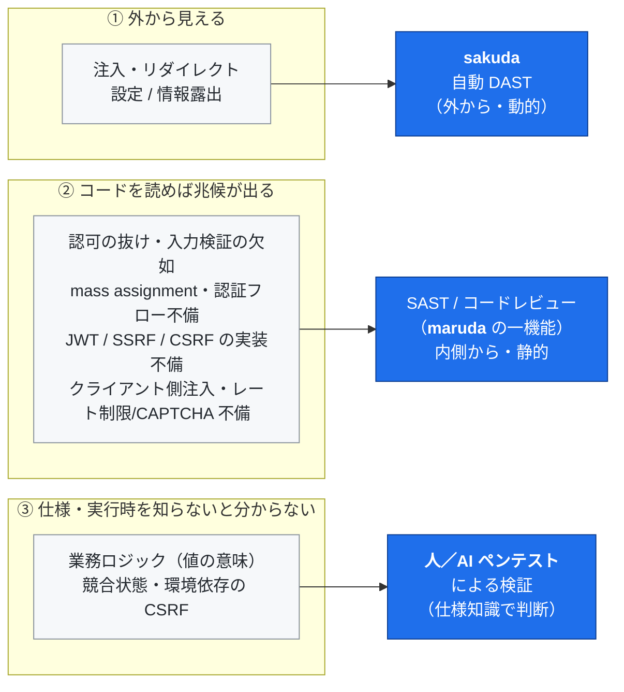

# 自動脆弱性診断はどこまで届くか — sakuda のカバー範囲と、人手が要る領域

[English](coverage-and-limits.md) | 日本語

> 対象読者: 脆弱性診断を担当するエンジニア、サービスの企画・運用に関わる方、これから診断を検討している方。
> 前提知識は不要です。専門用語は都度かみくだいて説明します。
> 本書は OSS プロジェクトのドキュメントです。

## この文書の目的

脆弱性診断には「自動ツールで効率よく見つけられるもの」と「自動ツールが仕様・業務の文脈を持たないために判定しにくく、人（や、十分に設計された AI ベースのペンテスト）の判断が要るもの」があります。この境界を知らないまま、**外から応答だけを見る自動診断**だけを実施すると、**「異常なし」＝「安全」だと誤解**しかねません。

本書は、OSS の自動 DAST（動的アプリケーション診断）ツール **sakuda** を題材に、

1. sakuda が自動でカバーできる領域
2. 外から応答だけを見る自動診断が**苦手とする**領域と、その理由（「どんな手段でも不可能」という意味ではありません）
3. では、その領域をどう埋めるのか

を、具体的な攻撃手順を伏せたうえで整理するものです。検証には、脆弱性診断の国際的な学習用アプリ **OWASP Juice Shop**（意図的に多数の脆弱性を埋め込んだベンチマーク）を用い、各領域で実際に成立することを確認済みです。

---

## まず要点（3分で読む方向け）

| 問い                           | 答え                                                                                                                                                                                                                                                               |
| ------------------------------ | ------------------------------------------------------------------------------------------------------------------------------------------------------------------------------------------------------------------------------------------------------------------ |
| sakuda だけで診断は完結する？  | **いいえ。** 注入・リダイレクト・設定/情報露出などは自動で効率よく検出しますが、認可・業務ロジック・認証・多段手順が絡む欠陥は、外から応答だけを見る自動診断の死角です（人や AI ベースのペンテストなら到達しうる領域で、「誰にも不可能」という意味ではありません） |
| なぜ自動では見つからないの？   | これらは**応答が「正常（成功）」として返る**ため。「その操作が本来許されてよいか」は仕様・業務の文脈が要り、文脈を持たない自動判定では正常応答と区別できません（人や、仕様を与えられた AI ベースのペンテストなら判断できます）                                     |
| 足りない部分はどう埋める？     | sakuda の死角のうち**コードを読めば分かるものは、コンパニオン OSS「maruda」の SAST／コードレビューが検出**し、残りを人による手動検証で確認します（maruda はセキュア開発向けの Claude Code スキル群で、CI 監査・Semgrep ガードレールも備える）                      |
| 具体的な攻撃手順は載せている？ | **領域と理由は公開し、悪用に直結する手順・ペイロードは載せません**（責任ある開示）。検証には OWASP Juice Shop を使用しています                                                                                                                                     |

> ひとことで言うと —— **自動診断は「送って返ってきた応答のおかしさ」を見る道具**です。応答自体はまっとうに見えるのに、その操作が本来は許されない、という種類の欠陥は、自動診断の守備範囲の外にあります。

---

## 1. sakuda が自動でカバーする領域

sakuda は入力点を自動で見つけ、次のような脆弱性を効率よく検出します。

- SQL インジェクション（ログイン・検索など）
- NoSQL インジェクション
- オープンリダイレクト
- セキュリティ設定・情報露出の一部（CSP / CORS / クロスドメイン / エラーメッセージからの情報漏れ など）

**設定を与えるとさらに広がります。** とくに **API 定義（OpenAPI）を渡せるか**で検出範囲が大きく変わります。診断対象のパス、認証情報、画面（SPA）の経路情報を提供いただくほど精度は上がります。この部分は「ツールの設定で補える」領域です。

---

## 2. 外から見る自動診断が苦手とする領域

### なぜ自動診断が苦手なのか

自動診断は、リクエストを送り、**返ってきた応答が異常か**（エラー、情報の漏れ、注入が成立した兆候など）を機械的に判定します。

ところが、ここで挙げる欠陥は、**応答が「正常・成功」として返ってきます。** たとえば「他人の注文が見えてしまう」操作も、サーバから見れば正常なデータ取得で、HTTP 的には成功（200）です。「この操作は本来許されてはいけない」という判断には、**そのサービスの仕様・業務ルール・権限設計の理解**が要ります。機械にはその文脈がないため、正常応答を正常としか扱えません。これが、外から応答だけを見る自動診断の死角です（＝「仕様の文脈を持たない自動判定」の限界であって、人や AI ベースのペンテストでも不可能、という意味ではありません。詳しくは本章末の補足）。

以下、専門外の方にも伝わるようかみくだいて整理します（実際の攻撃手順は非公開）。

### ① 「他人のものを操作できてしまう」系 — 認可の欠陥

- **他人のデータの閲覧・改ざん**：画面上の識別子（注文番号など）を別の値に差し替えると、他人の情報が見えたり書き換えられたりする。番号自体はただの数字なので、ツールは「正常なデータ取得」としか見ません。
- **権限の乗っ取り（本来サーバが決める属性をクライアントが上書き）**：登録時などに、本来サーバ側で決めるべき「管理者かどうか」といった属性を、利用者側の送信データで上書きできてしまう。
- **なりすまし投稿・他人リソースの編集**：所有者・投稿者の照合が抜けており、他人名義で投稿したり他人の持ち物を編集できる。

> なぜ自動では難しいか：**「その識別子やその属性が、その人のものか」は仕様知識**。ログイン自体は正しく通っているため、応答は完全に正常に見えます。

### ② 「値の意味」を知らないと判断できない系 — 業務ロジック

- **価格・数量・クーポン・会員条件などの改ざん**：値の「意味」（この割引は本来いくらまで、この会員条件は本来こう）を知らないと、異常だと判定できません。
- **入力値の範囲・整合性チェックがサーバ側にない**：画面では選べない範囲の値（例：1〜5 のはずの評価に範囲外の値）を裏側へ直接送ると、そのまま受理・保存される。画面（UI）でしか制限しておらず、サーバが検証していないケースです。

> なぜ自動では難しいか：**「業務上その値が許容範囲か」は仕様知識**。成功応答（200/201）で返るため、正常系にしか見えません。

### ③ 認証まわりの作り込み不足

- 現在のパスワードを確認せずにパスワードを変更できる、初期パスワードが弱い、など。
- フロー（手順）の仕様を理解していないと「これは欠陥だ」と判定できません。

### ④ 復号・多段・複数要因が絡む系

- **トークン（JWT）の署名検証の甘さ**：トークンを復号し、改ざんして、再署名して送って初めて「検証が甘い」と分かる、多段の手順が要ります。
- **SSRF（サーバを踏み台に内部へ到達）**：サーバに利用者指定の URL を代理で取りに行かせ、外部からは届かない内部資源へ到達する。応答が返らない「盲目型」も多く、到達の有無は外部の受信確認が要ります。
- **CSRF（別サイト経由での操作）**：成否が Cookie の設定（SameSite）やブラウザの既定挙動との組合せに左右され、利用環境によって結果が変わります。
- **クライアント側パラメータ経由の外部コンテンツ注入**：入力点が画面側（SPA）のコードの中だけに存在し、サーバの応答には現れないため、外から巡回するだけでは入力点を列挙すらできません。

### ⑤ 時間・連打・同時実行が絡む系 — アンチ自動化

- **連投を止める仕組み（レート制限）の不在**、**CAPTCHA 等が実際には自動化を止められない**実装。
- **競合状態（レース／TOCTOU）**：ほぼ同時の並行リクエストで「1 回限り」の制約が破れる。単発のリクエストしか見ない自動診断の死角です。

> **共通するポイント** —— 多くは「ログイン（認証）は通っているのに、**その識別子・属性・操作が本人／正当なものかの照合（認可・整合性）が抜けている**」形で現れます。自動診断は認証済みの正常応答を異常と区別できないため、ここは人（または仕様を与えられた AI ベースのペンテスト）の確認が要ります。

### 補足: 「原理的に不可能」という意味ではない

ここで「自動診断の死角」と呼んでいるのは、**外から送って返ってきた応答だけを、仕様の文脈なしに機械的に判定する**タイプの自動診断（signature／ヒューリスティック型 DAST）にとっての死角です。「どんな手段を使っても見つけられない」という意味ではありません。

- **仕様知識を持つ人**は、これらを手動検証で見つけられます。
- **十分に設計されたプロンプト駆動の AI ベースのペンテスト**も、業務ルールや値の意味を推論し、多段の手順を試し、同時実行を仕掛けることで、この領域に踏み込めます。近年の AI ペンテストは、従来「自動では無理」とされてきた範囲を押し広げつつあります。

ただし、人や AI がこの領域に踏み込めることは「自動 DAST が不要になる」ことを意味しません。残る論点は **「不可能かどうか」ではなく、コスト・実行時間・決定性（毎回同じ結果になるか）・再現性・網羅の保証、そして“何が正解か”を与えるオラクル（仕様・期待値）の供給** にあります。自動 DAST は安く・広く・決定的に外側を押さえ、人や AI は文脈を持ち込んで深く確定する——役割が違うからこそ、次章のように層を**重ねて**使います。

---

## 3. では、どう埋めるのか — 3 つの層を重ねる

死角を埋める鍵は、**外からの動的診断（sakuda）だけに頼らず、内側（ソースコード）と人の判断を重ねる**ことです。脆弱性は「どうすれば気づけるか」でおおまかに 3 つに分かれ、それぞれを拾う層が異なります。

図: 脆弱性の性質（上段）と、それを拾う層（下段）。自動 DAST が落とす②③を maruda と人／AI ペンテストが引き継ぐ。

この 3 層を次のように組み合わせます。

1. **自動 DAST（外から）** —— sakuda が注入・リダイレクト・設定/露出を効率よく広く検出する。
2. **SAST／コードレビュー（内側から）** —— sakuda が原理的に取りこぼす死角の多くは、**外から送って返ってくる応答には現れなくても、ソースコードを読めば兆候が見えます**。この層を担うのがコンパニオン OSS「[maruda](https://github.com/northraystudio/maruda)」です。maruda は**セキュア開発を支援する Claude Code スキル群**（コード品質・セキュリティ監査・ドキュメント・Issue 駆動実装）で、その **SAST／コードレビュー機能**が、sakuda では検出できない脆弱性のうちコードから拾えるものを検出します。具体的には:
   - **認可の抜け** —— 他人の資産に届く／所有者・投稿者の照合がない
   - **入力検証の欠如** —— 範囲・型・必須のサーバ側チェックがない（UI だけで制限している）
   - **権限・属性の上書き（mass assignment）** —— リクエスト本体をそのままモデルに束ねている
   - **認証フローの不備** —— 現在パスワード照合の欠如、弱い既定値
   - **危険な実装パターン** —— トークン（JWT）検証の甘さ、サーバがユーザー指定 URL を取りに行く実装（SSRF の芽）、anti-CSRF トークンの欠如 など
   - **クライアント側パラメータ → 外部コンテンツ注入** —— 画面側の値（`location.search`/`hash` など）を `src`/`href`/`fetch` の参照先に流す箇所。サーバ応答に現れないため、フロントのコードを読んで見つける
   - **アンチ自動化の実装不備** —— レート制限の有無、CAPTCHA の答えがクライアントに渡る／再利用できる、「1 回限り」の処理が check-then-act（トランザクション・一意制約・行ロックの欠如）になっている

   さらに maruda の SAST／コードレビューには、**「チェックが“在る”こと」と「実際に拒否して“効いている”こと」は別物**だという判定原則が組み込まれています —— 成功コードやアプリの自己申告ではなく、実際の副作用（本当に拒否されたか／不正な値が本当に残ったか）で判断します。

   maruda はこれを「見つける」だけに留めません。依存ライブラリの監査（audit）や Semgrep を **CI ゲート／フック（セキュリティ・ガードレール）** として組み込み、同じ観点をコード変更の段階で自動的に止める仕組みも提供します（＝環境側で品質とセキュリティを強制する）。

3. **人による手動検証（と、仕様を与えた AI ベースのペンテスト）** —— 価格・クーポンなど値の「意味」に依る業務ロジック、同時実行で崩れる競合状態の成立窓、環境に依存する CSRF の成否、応答が返らない blind な SSRF の到達など、コードを読むだけでは確定できない部分は、最終的に「その操作が本来許されるか」を**仕様知識を持つ人や、十分に設計された AI ベースのペンテスト**と動的な確認で見極める。AI ベースのペンテストはこの層を押し広げるが、決定性・再現性・網羅の保証やオラクル（期待値）の供給という課題は残るため、安く・広く・決定的に外側を押さえる自動 DAST を**置き換えるのではなく重ねて**使う。maruda はこうした項目を握りつぶさず、コード上の兆候を _Requires Runtime Verification（要・動的検証）_ として明示的にこの層へ引き継ぐ。

> 要点: **sakuda（動的・外から）× maruda（静的・内側から）× 人・AI ペンテストの判断** を重ねることで、自動診断だけでは落ちる領域を拾い上げます。
> なお本書が開示するのは「どの領域が／なぜ自動では届かないか」までで、悪用に直結する具体的な攻撃手順・ペイロード・検証スクリプトは、**責任ある開示**の観点から掲載しません。

---

## まとめ

- 自動診断（sakuda）は、注入・リダイレクト・設定/露出などを効率よく検出します。
- 一方で、**認可・認証・業務ロジック・多段手順・同時実行**に関わる欠陥は、応答が正常に見えるため**外から見る自動診断の死角**です（「誰にも不可能」ではなく、仕様の文脈を持たない自動判定の限界）。
- これらの死角のうち**コードを読めば分かるものは、コンパニオン OSS「maruda」の SAST／コードレビューがコード側から検出**します（maruda はセキュア開発向けの Claude Code スキル群で、依存監査や Semgrep の CI ゲートも備える）。値の意味・同時実行・環境依存など残る部分は、人による手動検証で確認します。
- この死角は「原理的に不可能」という意味ではありません。**仕様知識を持つ人や、十分に設計された AI ベースのペンテスト**は、この領域に踏み込めます。残る論点はコスト・決定性・再現性・網羅の保証とオラクル（期待値）の供給で、だからこそ各層を置き換えでなく**重ねて**使います。
- 各領域は国際的なベンチマーク（OWASP Juice Shop）上で実際に成立を確認済みです。悪用に直結する手順は伏せ、**どこに／なぜ人の確認が要るか**を公開することを本書の方針とします。

## 関連リンク

- maruda（セキュア開発向け Claude Code スキル群。SAST／コードレビュー・依存監査・Semgrep の CI ゲートを含む OSS）: https://github.com/northraystudio/maruda
