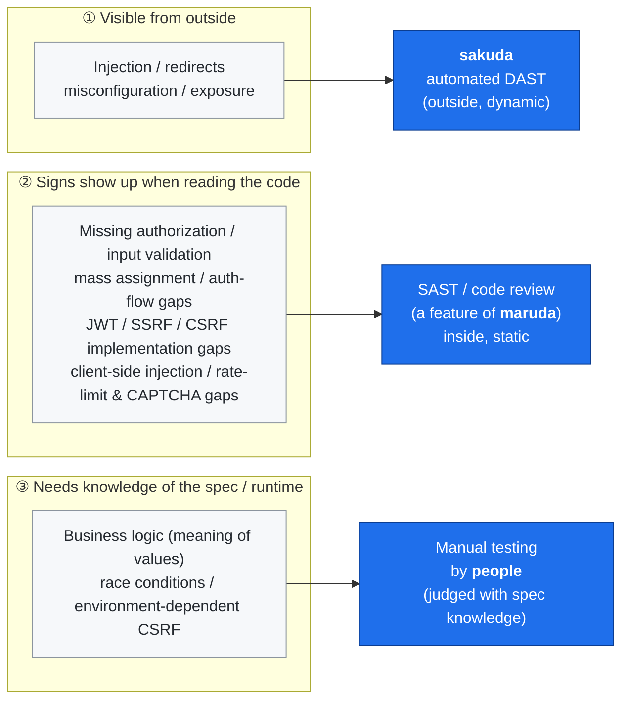

# How far can automated vulnerability scanning reach? — What sakuda covers, and where people are still needed

English | [日本語](coverage-and-limits.ja.md)

> Audience: engineers who run security assessments, people who plan or operate services, and anyone considering a security assessment.
> No prior knowledge is assumed; technical terms are explained as they come up.
> This document is part of an open-source project.

## Purpose of this document

Some vulnerabilities can be found efficiently by automated tools; others **cannot, in principle,** be found automatically and need human judgment. Running only an automated scan without knowing where that line lies invites the misreading that **"no findings" means "secure"**.

Using the open-source automated DAST (dynamic application security testing) tool **sakuda** as the example, this document lays out:

1. what sakuda covers automatically,
2. what automated scanning **in principle** cannot reach, and why,
3. how to fill that gap,

without disclosing concrete attack procedures. The analysis uses **OWASP Juice Shop**, the widely used training application for security testing (a benchmark with many intentionally planted vulnerabilities), and each area below was confirmed to be exploitable there.

---

## Key points (a 3-minute read)

| Question                                  | Answer                                                                                                                                                                                                                                                                                  |
| ----------------------------------------- | --------------------------------------------------------------------------------------------------------------------------------------------------------------------------------------------------------------------------------------------------------------------------------------- |
| Is sakuda alone enough for an assessment? | **No.** It efficiently finds injection, redirects, and misconfiguration / information exposure, but flaws involving authorization, business logic, authentication, or multi-step procedures are a fundamental blind spot of automated scanning                                          |
| Why can't automation find them?           | Because **the response comes back "normal" (successful).** Whether an operation should have been allowed in the first place can only be judged by someone who knows the specification and the business                                                                                  |
| How is the gap filled?                    | Of sakuda's blind spots, **those visible in the code are caught by the SAST / code review of the companion OSS "maruda"**, and the rest are confirmed by manual testing (maruda is a set of Claude Code skills for secure development, also providing CI audits and Semgrep guardrails) |
| Are concrete attack steps included?       | **The areas and the reasons are public; procedures and payloads that lead directly to exploitation are not** (responsible disclosure). OWASP Juice Shop was used for verification                                                                                                       |

> In one sentence — **automated scanning is a tool that looks for "something odd in the response to what it sent".** Flaws where the response looks perfectly reasonable but the operation itself should never have been allowed are outside its reach.

---

## 1. What sakuda covers automatically

sakuda discovers input points automatically and efficiently detects vulnerabilities such as:

- SQL injection (login, search, etc.)
- NoSQL injection
- Open redirects
- Part of security misconfiguration and information exposure (CSP / CORS / cross-domain / information leaking through error messages, etc.)

**Coverage grows with configuration.** In particular, **whether you can supply an API definition (OpenAPI)** makes a large difference to what can be detected. The more you provide — paths to scan, credentials, routing information for the single-page app — the better the accuracy. This is the part that "tool configuration can make up for".

---

## 2. What automated scanning cannot reach in principle

### Why "in principle"

Automated scanning sends requests and mechanically judges **whether the response that comes back is abnormal** (errors, leaked information, signs that an injection succeeded, and so on).

The flaws listed here, however, **come back as normal, successful responses.** An operation that "shows someone else's order", for example, is an ordinary data fetch from the server's point of view, and a success (200) in HTTP terms. Judging that "this operation should not be allowed" requires **understanding the service's specification, business rules, and permission design.** A machine lacks that context, so it can only treat a normal response as normal. This is the fundamental blind spot of automated scanning.

Below, these are explained in plain terms for non-specialists (actual attack procedures are not disclosed).

### ① "I can act on someone else's things" — authorization flaws

- **Viewing or tampering with other people's data**: replacing an identifier on the screen (an order number, for instance) with another value shows or modifies another person's information. The number is just a number, so the tool sees only "a normal data fetch".
- **Privilege takeover (the client overwrites attributes the server should decide)**: during sign-up or similar, an attribute the server should decide — such as "is this user an administrator" — can be overwritten by data the user sends.
- **Posting as someone else / editing others' resources**: the owner or author check is missing, so one can post under another person's name or edit things that belong to someone else.

> Why this is hard to automate: **whether that identifier or attribute belongs to that person is specification knowledge.** The login itself succeeds legitimately, so the response looks completely normal.

### ② You need to know what a value means — business logic

- **Tampering with prices, quantities, coupons, membership conditions, etc.**: without knowing what a value _means_ (how large this discount may legitimately be, what this membership condition should be), it cannot be judged abnormal.
- **No server-side range or consistency check on input**: sending a value the screen would never let you choose (for example, an out-of-range score for a rating that should be 1–5) directly to the backend gets it accepted and stored as is. The restriction exists only in the UI, and the server does not validate it.

> Why this is hard to automate: **whether a value is acceptable for the business is specification knowledge.** The response is a success (200/201), so it looks like the normal path.

### ③ Gaps in how authentication is built

- The password can be changed without confirming the current password, the default password is weak, and so on.
- Without understanding the specification of the flow, one cannot judge "this is a flaw".

### ④ Decoding, multiple steps, multiple factors

- **Weak verification of token (JWT) signatures**: you only learn that verification is weak after decoding the token, tampering with it, re-signing it and sending it — a multi-step procedure.
- **SSRF (using the server as a stepping stone into the internal network)**: the server is made to fetch a user-supplied URL on your behalf and reaches internal resources that are not reachable from outside. Many cases are "blind", returning no response, so confirming the reach requires observing a callback from outside.
- **CSRF (operations triggered via another site)**: success depends on the combination of cookie settings (SameSite) and the browser's default behavior, so the result changes with the environment.
- **External content injection through client-side parameters**: the input point exists only inside the screen-side (SPA) code and never appears in server responses, so crawling from outside cannot even enumerate it.

### ⑤ Timing, repetition, and concurrency — anti-automation

- **No mechanism to stop repeated submissions (rate limiting)**, and **CAPTCHAs and similar that do not actually stop automation**.
- **Race conditions (race / TOCTOU)**: nearly simultaneous parallel requests break a "once only" constraint. A blind spot for automated scanning that only looks at single requests.

> **The common thread** — most of these show up as "**authentication (login) succeeds, but the check that the identifier, attribute or operation belongs to / is legitimate for that user (authorization, consistency) is missing**". Automated scanning cannot tell an authenticated normal response from an abnormal one, so this needs human confirmation.

---

## 3. How to fill the gap — stacking three layers

The key to covering these blind spots is **not relying on external dynamic scanning (sakuda) alone, but layering the inside view (source code) and human judgment on top.** Roughly, vulnerabilities split into three kinds by "how can you notice them", and a different layer catches each.

Figure: the nature of a vulnerability (top) and the layer that catches it (bottom). maruda and people pick up ② and ③, which automated DAST misses.

The three layers combine as follows.

1. **Automated DAST (from outside)** — sakuda detects injection, redirects and misconfiguration / exposure efficiently and broadly.
2. **SAST / code review (from inside)** — many of the blind spots sakuda misses in principle **do not appear in the responses to requests sent from outside, but show signs when you read the source code.** This layer is handled by the companion OSS "[maruda](https://github.com/northraystudio/maruda)". maruda is **a set of Claude Code skills supporting secure development** (code quality, security audit, documentation, Issue-driven implementation), and its **SAST / code review feature** detects those vulnerabilities sakuda cannot find that are visible from the code. Specifically:
   - **Missing authorization** — reaching other people's assets / no owner or author check
   - **Missing input validation** — no server-side range, type or required checks (restricted only in the UI)
   - **Overwriting privileges or attributes (mass assignment)** — binding the request body directly to the model
   - **Authentication-flow gaps** — no current-password check, weak defaults
   - **Dangerous implementation patterns** — weak token (JWT) verification, server code that fetches user-supplied URLs (the seed of SSRF), missing anti-CSRF tokens, etc.
   - **Client-side parameters → external content injection** — places where screen-side values (`location.search` / `hash`, etc.) flow into the target of `src` / `href` / `fetch`. They never appear in server responses, so they are found by reading the front-end code
   - **Anti-automation implementation gaps** — whether rate limiting exists, a CAPTCHA answer reaching the client or being reusable, and "once only" processing written as check-then-act (no transaction, unique constraint or row lock)

   In addition, maruda's SAST / code review has a built-in judgment principle: **"a check _exists_" and "it actually rejects, i.e. it _works_" are different things** — it judges by the actual side effect (was the request really rejected? did the invalid value really persist?), not by a success code or the application's self-report.

   maruda does not stop at "finding" these. It also wires dependency audits and Semgrep in as **CI gates / hooks (security guardrails)**, so the same concerns are stopped automatically at the code-change stage (= the environment enforces quality and security).

3. **Manual testing by people (and dynamic confirmation)** — business logic that depends on what values _mean_ such as prices and coupons, the window in which a race condition holds under concurrency, whether an environment-dependent CSRF succeeds, the reach of a blind SSRF that returns no response — the parts that reading the code cannot settle are finally judged by **people with specification knowledge** and dynamic confirmation: "should this operation really be allowed?". maruda does not bury these items; it explicitly hands the code-level signs to this layer as _Requires Runtime Verification_.

> Key point: layering **sakuda (dynamic, from outside) × maruda (static, from inside) × human judgment** picks up the areas automated scanning alone drops.
> This document discloses only "which areas automation cannot reach, and why". Concrete attack procedures, payloads and verification scripts that lead directly to exploitation are **withheld for responsible disclosure**.

---

## Summary

- Automated scanning (sakuda) efficiently detects injection, redirects, misconfiguration / exposure and the like.
- Flaws involving **authorization, authentication, business logic, multi-step procedures and concurrency**, on the other hand, look like normal responses, and are **a fundamental blind spot of automated scanning.**
- Of these blind spots, **those visible in the code are detected from the code side by the SAST / code review of the companion OSS "maruda"** (a set of Claude Code skills for secure development, also providing dependency audits and Semgrep CI gates). What remains — the meaning of values, concurrency, environment dependence — is confirmed by manual testing.
- Each area was confirmed to be exploitable on an established benchmark (OWASP Juice Shop). This document's policy is to withhold procedures that lead directly to exploitation and to publish **where, and why, human confirmation is needed.**

## Related links

- maruda (open-source Claude Code skills for secure development, including SAST / code review, dependency audits and Semgrep CI gates): https://github.com/northraystudio/maruda
